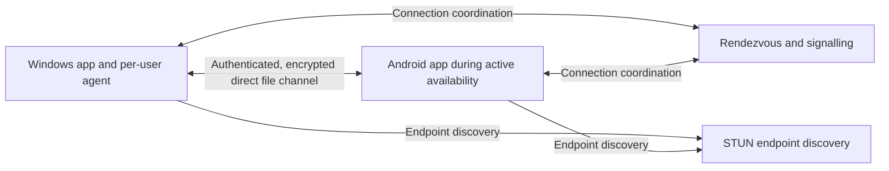

# iConnect White Paper

## Secure, accountless file access between Windows and Android

- **Version:** 1.0
- **Date:** 2 November 2026
- **Status:** Product vision and proposed architecture
- **Repository:** [JAPHARYROMAN/iConnect](https://github.com/JAPHARYROMAN/iConnect)

**Public edition:** A reader-facing version is available in [WHITEPAPER_PUBLIC.md](WHITEPAPER_PUBLIC.md), with a designed [PDF edition](output/pdf/iConnect-Whitepaper-Public.pdf). The public edition presents the same product foundations for external readers; this document retains the fuller engineering direction. To rebuild the PDF, install `tools/requirements-whitepaper.txt` and run `python tools/build_public_whitepaper.py`. The public Markdown is the PDF's content source.

This paper develops the original iConnect concept into a product direction with stronger usability, reliability, and security. It preserves the agreed foundations: Windows and Android, accountless pairing, direct internet connectivity, explicit drive access, and Android availability during active use. Features and safeguards described here are design requirements and proposals, not claims of implementation, measured performance, or completed security certification. Detailed protocols and engineering decisions require separate specifications and validation.

## 1. Executive summary

iConnect gives people a secure way to reach files on their own devices without a USB cable or an intermediate cloud upload. From an Android phone, a user can browse approved Windows storage, find a document, preview it, and download it. From Windows, the user can browse approved Android folders while the phone application is active. Both applications support controlled file management and reliable transfers in either direction.

The product's central promise is:

> Open iConnect, choose a trusted device, and work with the files you have allowed it to share.

The design separates connection coordination from file access. A small internet service helps paired devices find one another and exchange connection information. Encrypted file traffic travels directly between the devices. The coordination service has no authority to grant access to files, and the product provides no cloud file-storage or file-relay service.

The proposed improvements make this experience more useful and safer: permission profiles for each device, an upload-only inbox, expiring access, convenient share actions, responsive search, recoverable transfers, explicit overwrite decisions, and a clear view of connected devices and their permissions.

There are two essential limits. The source device must be awake, connected, and available. Also, direct internet connectivity cannot succeed on every network. iConnect must explain these limits honestly and provide useful diagnostics. Its first engineering milestone is therefore an authenticated Windows-to-Android connection across separate networks, followed by a verified test transfer.

## 2. The problem and intended users

Files often remain on the device where they were created. A person away from their laptop may need a report, photograph, presentation, or downloaded document that was never copied elsewhere. Moving it through email or cloud storage adds steps and may create additional retained copies. A USB cable requires both devices to be physically present.

iConnect serves individuals who want direct access to their own devices: students retrieving coursework, professionals reaching working documents, creators moving media, and people organizing personal files across Windows and Android. These are proposed use cases; demand, willingness to pay, and product differentiation require user research.

The opportunity is to combine three experiences in one understandable workflow: browsing remote files, transferring them reliably, and controlling which actions a trusted device can perform. The interface should make remote storage feel familiar while always identifying which device owns the files.

The initial product focuses on personal device relationships. Shared computers, organizational administration, delegated staff access, and regulated deployment requirements would introduce additional identity and governance needs and belong in a separate product assessment.

## 3. Product foundations

| Foundation | Product commitment |
| --- | --- |
| Platforms | Native Windows desktop and Android mobile applications. |
| Identity | No mandatory account, email address, phone number, or central password. Each installation has a cryptographic device identity. |
| Trust | Pairing requires owner approval and verification. Trust is stored on the devices. |
| Connectivity | Internet-based coordination with direct peer-to-peer file traffic. No TURN or application-server relay fallback. |
| Windows access | Users may explicitly approve whole drives or narrower folders. Existing Windows permissions remain authoritative. |
| Android access | Users approve supported folders through Android storage mechanisms. The phone is remotely available during active use or an explicitly authorized session. |
| Data ownership | Source files stay on the owning device until a user requests a transfer. No central document library or private-file index. |
| Safety | Pairing does not grant file access. Transfer completion requires integrity verification. Destructive actions receive stronger controls. |

These foundations constrain the roadmap. Adding accounts, permanent Android hosting, cloud backup, or relayed file traffic would require an explicit architecture revision rather than an incidental implementation change.

## 4. The intended experience

### First connection

The user installs both applications and selects **Add device** on Windows. Android scans a short-lived QR invitation. The devices display a matching verification code, and the owner confirms the relationship. The owner then chooses what each device may access; no drives or folders are automatically shared.

A simple permission screen offers understandable starting profiles, with details available when needed. The default is read-only access to a deliberately selected location. Whole-drive sharing remains available as an explicit, broader choice.

### Everyday access

Later, the user opens iConnect on the phone and sees paired computers with clear availability states. Selecting an available computer opens its approved storage. Breadcrumbs, favorites, sorting, search, and previews help locate a file. **Save to phone** starts a transfer to a chosen local destination.

The reverse flow works while Android is available: Windows shows the phone's approved folders and supported actions. Either application displays transfer progress, pending decisions, and completion status. An unavailable action explains the missing permission or storage-provider limitation.

### Interrupted work

If connectivity drops, the transfer becomes interrupted rather than completed. Progress remains recorded locally. After an authenticated reconnection, iConnect checks permissions and source identity before resuming. A changed source file or conflicting destination requires a fresh decision. Queued work never becomes authorization for new access after a grant expires or is revoked.

## 5. Feature strategy and improvements

The first release should deliver the complete core workflow. Convenience features should follow evidence that pairing, authorization, and transfer integrity work reliably.

| Capability | Proposed behavior and value | Priority |
| --- | --- | --- |
| Two-way remote explorer | Browse approved storage, inspect metadata, sort, search filenames, select multiple items, and distinguish local from remote locations. | Initial release |
| File management | Copy, move, rename, delete, and create folders where the owner and storage provider permit them. Show partial failures clearly. | Initial release. Windows stages verified local file and folder moves and single-file moves to Android with source recovery. Android supports owner-reviewed offline folder creation. Two-volume and separate-network validation, other cross-device move paths, and provider-safe actions remain open. |
| Reliable transfer manager | Queue files and folders, pause, cancel, resume after interruption, verify integrity, and preserve directory structure. | Initial release |
| Useful previews | Start with images, bounded text, and supported PDF previews. Report unsupported formats and limit preview size and processing cost. | Initial release, limited formats |
| Device and permission center | Show who is connected, what they may access, recent activity, grant expiry, and immediate local pause or revocation controls. | Initial release |
| Access profiles | Offer read-only, contribute, and manage profiles, with separate overwrite and delete permissions. Support narrower exceptions within a drive grant. | Initial release |
| Upload-only inbox | Let a paired device deliver new files to a designated folder without reading existing contents or replacing existing files. Apply quotas and storage checks. | Follow-on enhancement |
| Favorites and recent locations | Return quickly to frequently used folders. Keep history local and recheck permissions before opening a saved location. | Follow-on enhancement |
| System share actions | Send selected files from Android's share sheet or Windows shell actions after choosing a trusted destination. Receiving devices enforce their normal grants. | Follow-on enhancement |
| Expiring and session access | Approve a trusted device for a limited period or session without creating a permanent broad grant. Expiry is enforced by the file owner. | Follow-on enhancement |
| Network and cost controls | Show actionable connection failures, metered-network preferences, bandwidth limits, and understandable transfer estimates. | Both clients support payload limits, optional pause on metered or unknown networks, lifetime-aware receiving estimates and reviewed source refresh. Receiving owners can review an ordinary upload's write window while retaining its grant and publication decisions. Both clients expose all-peer prepared sources and offline stop and expiry cleanup. Observed payload estimates cover ordinary uploads, individual batch files, remaining planned batch sends and local copies. Forecasts for the complete operation and field verification remain open. |
| Local-network continuity | Explore direct discovery and transfers on the same network during a coordination-service outage. Discovery must not establish trust by itself. | Follow-on enhancement |

Search should run on the device that owns the files, inside the requester's authorized scope. An initial filename search avoids uploading a private index. Content indexing, if later justified, should be optional and local, with a separate privacy and resource-use review.

The product should support large files and useful folder batches without requiring full-file buffering. It should handle Unicode names, including Swahili filenames, and explain names or metadata that cannot be represented faithfully at the destination. Conflicts offer **keep both**, **skip**, or explicitly authorized **replace**; silence must never mean overwrite.

Accessibility belongs in the core experience: keyboard navigation on Windows, screen-reader labels, scalable text, adequate contrast, and status cues that do not rely on color. Technical diagnostics can be detailed without making routine file access depend on networking knowledge.

## 6. High-level architecture

### Separate coordination, trust, and file handling

The architecture has four principal parts:

| Part | Responsibility | Boundary |
| --- | --- | --- |
| Windows application and per-user agent | Pairing, availability, drive grants, file operations, transfer processing, and local history. | Runs with the logged-in user's privileges; no automatic administrator elevation. |
| Android application | Pairing, remote browsing, approved local storage, active sessions, and user-initiated transfers. | Respects Android lifecycle and storage-provider capabilities. |
| Rendezvous and signalling service | Temporary presence, invitation coordination, and bounded exchange of connection messages. | Cannot authorize file operations; accepts no product file-upload or directory-index API. |
| STUN service | Helps devices discover network endpoints for direct connection attempts. | Does not forward application file traffic. |

The diagram describes application data flow. Packets still traverse ordinary network infrastructure and any user-configured VPN; direct-only means iConnect provides no intermediary file relay.

### Connectivity policy

WebRTC DataChannels are the proposed transport. They carry application data using SCTP over DTLS; iConnect selects reliable delivery for file operations and transfer data. ICE performs connectivity checks, with STUN assisting endpoint discovery. These mechanisms are described in [WebRTC Data Channels, RFC 8831](https://www.rfc-editor.org/rfc/rfc8831.html) and [ICE, RFC 8445](https://www.rfc-editor.org/rfc/rfc8445.html).

Direct host, server-reflexive, and peer-reflexive candidate paths may be used. Relay candidates are rejected, and no TURN server is configured. An unsuccessful connection ends after a bounded attempt and produces a retryable error; the service must never quietly carry the file instead.

Some NAT combinations, blocked UDP paths, and restrictive firewalls will prevent a usable direct connection. The product should distinguish peer offline, coordination unavailable, negotiation timeout, and authentication failure. It should not diagnose a specific NAT problem without sufficient evidence or recommend disabling security protections. Router port forwarding and automatic router reconfiguration are outside the normal setup flow.

### Technology direction

The baseline is C# with .NET 10 and WinUI 3 on Windows, Kotlin with Jetpack Compose on Android, and ASP.NET Core for coordination. Microsoft lists .NET 10 as an LTS release in its [official support policy](https://dotnet.microsoft.com/en-us/platform/support/policy/dotnet-core). Supported Windows releases and Android versions must be confirmed against runtime, SDK, and distribution requirements before release; the engineering starting targets are Windows 11 x64 and Android 10 or later.

Native WebRTC bindings remain a feasibility decision. Selection must consider Windows/Android interoperability, security maintenance, packaging, licensing, and access to certificate fingerprints and transport statistics. A successful same-network demo is insufficient evidence for committing to a binding.

The application protocol should be documented, versioned, and shared across platforms, using Protocol Buffers for structured contracts and bounded binary transfer frames. Message sizes, concurrent work, and preview requests need limits. Protocol changes require compatibility tests and safe rejection of unsupported required features. Cryptography and transport should come from maintained implementations.

Begin with one coordination service and short-lived in-memory state. Introduce distributed presence only when measured demand requires it. Trust records, grants, and transfer checkpoints remain local. A backend restart may temporarily interrupt discovery but must not destroy established device trust.

## 7. Security model

### 7.1 Threat assumptions and protection limits

iConnect must assume that internet traffic can be observed or modified, a coordination service can be compromised, pairing invitations can leak, and an already paired device can become malicious. Remote filenames, metadata, directory trees, and preview content are untrusted inputs.

The file-owning device makes every authorization decision. A device name, online status, possession of an invitation, or successful network connection is never sufficient proof of permission.

Security has practical limits. A compromised endpoint may access plaintext and misuse whatever permissions it holds. Read access can be enough to steal sensitive data; write or delete access can enable widespread damage. iConnect cannot retract downloaded copies, guarantee recovery after deletion, or protect a file from malware already controlling the owning operating-system account.

### 7.2 Accountless identity and verified pairing

Each installation generates a long-lived signing key and derives a device fingerprint from a canonical public-key representation. ECDSA P-256 and SHA-256 are the proposed identity baseline, subject to cross-platform verification and cryptographic review. Device names are labels, not identifiers.

Windows should protect identity keys through CNG, and Android should use Android Keystore, preferring hardware-backed protection where available. Key material should be non-exportable where supported. Hardware protection reduces extraction risk but does not prevent a compromised authorized process from requesting key operations. See [Microsoft CNG key storage](https://learn.microsoft.com/en-us/windows/win32/seccng/key-storage-and-retrieval) and [Android Keystore](https://developer.android.com/privacy-and-security/keystore).

Pairing needs both a secure invitation and human verification:

1. Generate a single-use invitation with at least 128 bits of random secret material and a maximum lifetime of two minutes.
2. Bind the invitation to the initiating device's public-key fingerprint and the configured coordination service. A scanned QR code cannot silently select an arbitrary service.
3. Require proof of possession of both device keys, then display a verification code derived from both identities and the pairing exchange.
4. Require matching-code confirmation and owner approval before either device saves a trusted relationship. A mismatch or expired invitation aborts pairing.
5. Grant file permissions separately. Pairing alone exposes no storage.

Invitation claims must be rate limited and resolved atomically to prevent reuse. Tokens and QR secrets must be excluded from logs and analytics. If a short manually entered pairing code is introduced, use a reviewed password-authenticated key exchange rather than treating a guessable code as a high-entropy secret.

The exact pairing exchange needs a documented security analysis. A short verification code is a human check, not a substitute for authenticated cryptographic exchanges or protection against repeated attempts.

### 7.3 Bind trusted identity to the encrypted session

DTLS protects the transport, but iConnect must also verify that the endpoint is the device approved during pairing. The session design must bind both stored device identities to the actual WebRTC certificate fingerprints, fresh challenges, session roles, and negotiated protocol version. An authentication result from one connection cannot authorize another.

This binding is required before browsing or file transfer begins. It prevents a compromised signalling service from substituting its own endpoints merely by changing connection descriptions. Freshness checks and session-bound request identifiers prevent replay; incompatible or weaker authentication versions must fail closed. These are iConnect design requirements informed by the identity and transport concerns in the [WebRTC Security Architecture, RFC 8827](https://www.rfc-editor.org/rfc/rfc8827.html), not a claim that WebRTC automatically supplies the complete device-trust model.

Use a reviewed session construction and established libraries. Additional encryption layers should be introduced only for a demonstrated requirement; adding unreviewed cryptographic machinery would increase complexity without establishing stronger security.

### 7.4 Permissions that match the action

An access grant should identify the trusted peer, storage location, allowed operations, optional expiry, and applicable limits. Profiles simplify this model, while the owner can inspect individual permissions.

| Profile | Allowed behavior | Default restrictions |
| --- | --- | --- |
| Read-only | List, search, preview, and download within the grant. | No upload, modification, move, or delete. |
| Contribute | Read and create new files or folders. | No replacement of existing content or source deletion. |
| Manage | Owner-selected file-management operations. | Overwrite and delete require explicit grants and appropriate confirmation. |
| Upload-only inbox | Create new files in one designated location. | No browsing, reading existing files, overwrite, or delete; quotas apply. |

Full-drive authorization remains supported. It must explain the breadth of exposure, start with read-only permissions, and allow narrower exclusions that override the broader grant. Protected credential locations, iConnect identity material, and operating-system internals should be excluded from normal remote operations. Exclusions reduce risk but cannot identify every sensitive file on a drive; a whole-drive grant remains a significant owner decision.

Peers cannot approve new peers, widen their own grants, or alter the owner's security settings. Local permission changes require an unlocked owner interface. Expiry and revocation are checked during active work as well as at session creation. A global **Pause remote access** control stops new requests and cancels active access promptly.

### 7.5 Enforce storage boundaries on the host

Windows access should use owner-issued, session-scoped references to approved objects rather than trusting arbitrary remote absolute paths. Validate both source and destination for every operation. Reject traversal, device paths, alternate data stream tricks, and names that escape or confuse the intended storage boundary.

Links and junctions require special handling because they can redirect file access; Windows describes these mechanisms under [reparse points](https://learn.microsoft.com/en-us/windows/win32/fileio/reparse-points). The initial policy should reject unsupported link traversal and use handle-based validation to resist a target being replaced between checking and opening. Bind drive grants to volume identity, so a reused drive letter does not silently authorize a different disk. Hard links and other aliases must also be assessed before writable folder-boundary claims are made.

Run the Windows agent as the ordinary user. It cannot bypass ACLs, access raw disks, unlock protected files, or elevate itself to satisfy a remote request. Local communication between the interface and agent must be restricted to the intended Windows user.

On Android, use persisted Storage Access Framework grants and appropriate media APIs. Android restricts access to certain roots and directories, and document providers differ in the operations they support. A selected provider may also be cloud-backed; to preserve the initial local-device scope, unsupported remote-backed locations should be excluded or clearly identified before use. See [Android's storage access guidance](https://developer.android.com/training/data-storage/shared/documents-files).

### 7.6 Reduce damage from trusted-device misuse

Per-device permissions limit exposure but do not make a compromised peer harmless. Add bounded request rates, transfer quotas, bulk-operation summaries, and additional approval for unusually large destructive batches. Optional policies can suspend remote access when the owning computer locks or require an unlocked local interface for destructive work. Persistent unattended read access should remain an explicit owner choice.

Previews must use constrained, maintained parsers with resource limits and no automatic execution of scripts, macros, or downloaded programs. Transferred files remain untrusted; checksum verification establishes byte integrity, not that a document is safe. Preserve available operating-system security metadata and scanning behavior where the platform permits it.

Use recoverable deletion where supported. If a provider offers only permanent deletion, state that clearly and require the relevant confirmation. Do not present an undo action unless recovery is actually available.

### 7.7 Revocation, key changes, and device loss

Revoking a peer locally invalidates its grants and sessions and rejects future authentication. The enforcement point is the device that owns the files; delivering a notification to the revoked peer is unnecessary for local enforcement. Interrupted transfers must not resume under revoked permissions.

There is no universal cloud recovery or remote-wipe authority. A lost phone can be revoked on each Windows computer that trusted it. Revoking it on one computer does not automatically update other devices. When the relevant host is unavailable, access to that host is needed to change its local trust records.

Reinstallation or key loss creates a new identity and requires pairing again. A known device presenting a different key must never be accepted by name alone. In-place key rotation would require an authenticated continuity design; migration and identity backup should remain deferred until their recovery and theft risks are addressed.

### 7.8 Secure distribution and maintenance

Security continues after pairing. Release requirements include signed installers and application packages, protected release credentials, dependency review, a software bill of materials, and a process for reporting and fixing vulnerabilities. WebRTC and file-preview dependencies need particular attention because they process complex remote input.

Update authenticity must not depend on HTTPS alone. Use the distribution platform's verification model or a reviewed updater with signed, versioned, expiring metadata and rollback protection. [The Update Framework](https://theupdateframework.io/docs/overview/) provides a reference approach for strengthening update systems against repository and signing-key compromise. Update-signing keys must be separate from device identity keys.

## 8. Transfer reliability and safe file operations

A transfer is a durable local job with a source identity, destination, progress checkpoints, and a verifiable outcome. It should use bounded chunks, backpressure, controlled concurrency, and size limits negotiated for the selected WebRTC implementation. Separate logical control and data channels should help keep cancellation and status responsive during large transfers.

The receiver writes to a temporary destination and records only verified, durably retained progress. After reconnection, the peers reauthenticate, recheck grants, compare source identity and content expectations, and validate the checkpoint before resuming. If the source changed, restart or request a new decision. A final SHA-256 digest must match an expected digest delivered through the authenticated session before the file is marked complete.

Finalization should be atomic where the destination supports it. Where an Android document provider cannot guarantee atomic rename or replacement, use a provider-specific safe strategy or declare the operation unsupported; do not imply stronger guarantees than the provider supplies. Temporary files and previews need owner-visible retention and cleanup policies.

Cross-device move means **copy, verify, finalize, then delete the source under explicit authorization**. It is not a distributed atomic operation. If the destination commits but the final acknowledgement is lost, reconciliation should leave a possible duplicate rather than risk deleting the only valid copy. Deletion is retried only after confirming the committed destination and that the source still matches the transferred version.

Folder transfers use a validated manifest, preserve empty directories where supported, and report success per item. Unsupported links, unavailable files, insufficient space, destination size limits, and partial failure must remain visible. An overall success badge cannot hide a failed file.

Retries for mutations require operation identifiers and durable reconciliation so a repeated message does not duplicate a rename, upload, or delete. These details belong in the protocol specification and fault-injection tests before production use.

## 9. Availability, privacy, and service operation

### Platform lifecycle

The Windows agent may start at user login with permission and stay available in the notification area. Sleep, logout, lost connectivity, or an unavailable agent means remote access is unavailable. Remote wake-up is not a first-release promise.

Android availability begins when the user opens the application or explicitly authorizes an active session. Leaving the interface must not silently create a permanent file server. A user-started transfer may continue under the platform's supported mechanisms, with a visible notification and controls. On Android 14 and later, user-initiated data transfer jobs are an option; they remain subject to system conditions. Older versions require an appropriate supported mechanism. See [Android user-initiated data transfers](https://developer.android.com/develop/background-work/background-tasks/uidt).

Continuing a transfer must not authorize unrelated browsing or new transfers in the background. Availability advertisements expire when active availability ends. Force-stop, provider revocation, or battery restrictions can interrupt work, making persisted recovery necessary.

### Data minimization

Accountless operation reduces registration data; it does not provide anonymity. Paired peers see network addresses, STUN observes endpoint metadata, and the coordination operator may see source addresses, timing, and connection relationships.

Use authenticated, short-lived presence leases and pair-specific, unguessable discovery capabilities rather than a public directory of device identifiers. Discovery capabilities assist routing, not file authorization. Their rotation and abuse controls require a documented design. A service operator may still correlate traffic, so the product must not claim complete unlinkability.

The coordination service must not collect filenames, previews, directory listings, file contents, or content hashes as product telemetry. Local history records device, action, time, size where useful, and outcome; filenames and paths remain protected local information. Keep local retention configurable, redact diagnostic exports, and require deliberate user action before sending support bundles.

### Sustainable infrastructure

Direct transfer avoids operating a file-storage and relay-bandwidth service, but coordination, STUN, abuse prevention, monitoring, signing, and security maintenance still cost money. Measure service use before choosing pricing or promising unlimited usage. Any later paid convenience should preserve the accountless core and the stated file-access boundaries.

Operate coordination with authenticated device challenges, strict message schemas, quotas, invitation-attempt limits, short expirations, and bounded resource use. Protect connection routing from spoofed presence. Service compromise may still disrupt or correlate connections; it must not let the operator manufacture trusted peers or bypass host permissions.

Start with operational metrics that avoid document details. Publish a service-status and vulnerability-response process before broad distribution. A future self-hosted coordinator could offer deployment choice, but requires clear endpoint trust and reconfiguration behavior and is outside the first release.

## 10. Development roadmap and evidence gates

The roadmap is staged by evidence rather than calendar promises. No implementation or certification is implied by this paper.

| Stage | Deliverable | Evidence required to proceed |
| --- | --- | --- |
| 0. Connectivity feasibility | Minimal Windows and Android clients, device keys, verified pairing, coordination, direct WebRTC connection, and a test transfer. | Authenticated transfer across separate real internet networks; matching digest; selected non-relay candidate evidence; service instrumentation showing no file-transfer endpoint or file payload handling. Record failed network cases too. |
| 1. Trust and storage boundaries | Persistent trust, revocation, per-peer drive/folder grants, safe directory listing, and local security controls. | Reject unpaired and revoked peers, forged sessions, replayed pairing, traversal, and link escapes. Demonstrate that ordinary OS permissions remain effective. |
| 2. Core file experience | Two explorers, scoped search, limited previews, two-way file and folder transfers, and basic file management. | Complete representative user journeys in both directions. Confirm that Android exposes only approved storage during permitted availability. |
| 3. Recovery and damage controls | Durable checkpoints, safe moves, collision handling, quotas, and provider-aware operations. | Fault-injection tests for disconnects, crashes, changed sources, lost acknowledgements, low storage, and partial batches; no false completion or premature source deletion. |
| 4. Release readiness | Signed distribution, update verification, accessible interfaces, diagnostics, operational monitoring, and documented support. | Independent review of authentication and filesystem boundaries, dependency assessment, device/network matrix, and a release checklist with no unresolved release-blocking defects. |
| 5. Measured improvements | Inbox grants, share actions, favorites, richer metered-network controls, and local-network continuity. | User research and field evidence justify each addition; the relevant trust, lifecycle, and reliability guarantees remain intact. |

The test matrix must include separate Wi-Fi networks, mobile data, IPv4 and IPv6, restrictive NAT/firewall cases, network switching, sleeping devices, and coordination outages. File coverage includes empty files, files larger than 4 GiB, deep directory trees, Unicode names, locked files, duplicate names, and incompatible destination capabilities. Test supported Android versions and representative manufacturer battery policies rather than relying only on emulators.

Packet capture and selected-candidate statistics can support direct-path verification, while backend inspection verifies the intended service boundary. No single successful test establishes universal reachability, proves the absence of every security flaw, or replaces protocol review.

## 11. Measuring success and managing open risks

Product success means users can retrieve the right file with confidence and understand when access is unavailable. Initial measures should include:

- Time from installation to the first verified two-way transfer, plus pairing abandonment and support requests.
- Connection success and time to connect, reported by network class with failures included in the denominator.
- Transfer goodput, peak memory, battery impact, cancellation response, and successful recovery after interruption on declared test hardware.
- Verified completion rate, unexpected overwrites, permission violations, and source loss during move tests.
- User ability to identify a remote location, explain a permission grant, and revoke a device without assistance.

No performance figures are claimed here. Quantitative budgets should be set after feasibility measurements and published with hardware, network, file-size, and platform conditions. Undetected corruption, unauthorized access, and unsafe source deletion are release-blocking defects rather than acceptable statistical outcomes.

| Open risk or decision | Required response |
| --- | --- |
| Direct-only reachability may not meet user expectations. | Measure it across target networks and make limits visible before launch. Reconsider the product promise if evidence is inadequate; introducing a relay requires explicit revision. |
| Native WebRTC bindings may be difficult to maintain. | Prove interoperability, inspect security-update cadence, and resolve licensing before major UI investment. |
| Full-drive grants greatly increase exposure. | Recommend narrow read-only grants, preserve explicit drive choice, and test exceptions and mutation controls rigorously. |
| Accountless operation has limited centralized recovery. | Make device-loss and re-pairing behavior explicit; do not promise global revocation or recoverable private keys. |
| Android providers and background rules vary. | Discover capabilities, implement supported lifecycle paths, and document unsupported operations. |
| A compromised paired device can misuse valid permissions. | Minimize grants, bound bulk work, provide local pause/revocation, and communicate the residual risk. |
| A small team may underfund security maintenance. | Budget dependency updates, incident response, signing, and service operation before expanding scope. |

Cloud synchronization, backup, TURN relays, remote desktop, command execution, automatic content execution, organization-wide administration, and additional operating systems are outside the initial scope. The long-term opportunity is a dependable personal-device file bridge; expanding it should depend on observed needs and explicit security review.

## 12. Source basis and next decision

The product origin and initial decisions are documented in the [shared iConnect concept conversation](https://chatgpt.com/share/6ae8b237-7adc-83ea-afe5-aefe29fd06e2). This paper's feature priorities, permission profiles, operational requirements, and risk responses are proposals developed from that baseline. Linked IETF, Android, Microsoft, and TUF materials support the underlying protocol and platform discussion; they do not endorse or certify iConnect.

The next decision is whether the feasibility evidence supports the intended direct-only experience for the target users. Establish that evidence first, then publish the reviewed pairing/session contract, storage authorization model, and transfer recovery specification that turn this vision into an implementable product.
