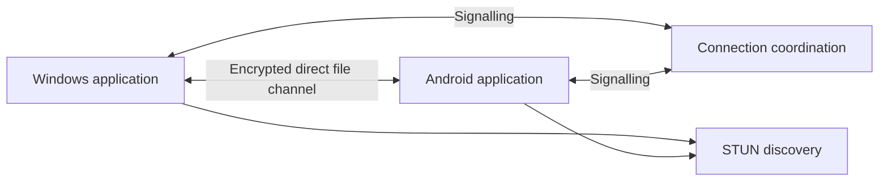

# iConnect

## Secure, accountless file access between Windows and Android

**Public White Paper | Version 1.0 | 2 November 2026**

> Your files. Across your devices. Under your control.

**Publication status:** iConnect is a proposed product. This paper presents its intended experience, design principles, and development direction. It does not announce a released application or claim independently verified security or performance results.

**Project:** [github.com/JAPHARYROMAN/iConnect](https://github.com/JAPHARYROMAN/iConnect)

## 1. A simpler path to your files

The document you need is often on the device you left behind. A report remains on a laptop, a photograph sits on a phone, or a folder has never been copied to another location. Retrieving it can mean finding a cable, sending an attachment, or uploading another copy to a storage service.

iConnect proposes a more direct experience: open an application, choose a trusted device, and browse the files its owner has approved for access. From Android, a user could find a document on a Windows computer and save it to the phone. From Windows, the user could retrieve files from approved Android folders while the phone is available.

The aim is a dependable personal file bridge. Browsing, transfer, and essential file management would share one interface, with clear permission boundaries and reliable recovery when a connection is interrupted.

### Three design commitments

- **Accountless trust.** Pair devices through cryptographic identities and owner approval, without mandatory registration or a central password.
- **Direct delivery.** Use internet services to coordinate connections, while file traffic travels through an encrypted connection between the devices.
- **Owner control.** Let the device holding the files decide who may access them and which actions are permitted.

The intended users include students reaching coursework, professionals retrieving working documents, creators moving media, and people organizing their personal files. These use cases guide the proposal; their demand and practical value still require user research.

### A familiar everyday journey

Pair once. Approve a location. Later, open iConnect, select the available computer, navigate to a document, and choose **Save to phone**. The application should show progress and report completion only after it has verified the received file.

## 2. One file experience, in both directions

The proposed first release combines remote browsing, two-way transfer, and controlled file management. The interface should always identify the device that owns a location and the destination for each transfer.

### The core experience

| Capability | What it means for the user |
| --- | --- |
| Remote explorer | Navigate approved folders, inspect file details, sort results, search filenames, and select several items. |
| Two-way transfers | Send files and folders between Windows and Android, with progress, cancellation, and interrupted-transfer recovery. |
| Essential management | Create folders, copy, move, rename, and delete where permissions and the destination platform allow. |
| Useful previews | Inspect supported images, text, and documents with clear limits for unsupported formats and large files. |
| Permission center | See trusted devices, active connections, approved locations, and recent activity; pause access or revoke a peer. |

Search should stay on the device holding the files, within the requester's permissions. Large transfers should use bounded memory, and folder batches should report individual failures clearly.

### Convenience without broader exposure

Later enhancements could include favorite locations, Android share-sheet and Windows shell actions, bandwidth controls, and access that expires automatically. An **upload-only inbox** could let a paired device deliver new files to one folder without reading its existing contents or overwriting them.

Same-network discovery during an internet-service outage is another possible enhancement. Discovery would help find a device; it would never make that device trusted automatically.

Accessibility includes readable text, Windows keyboard navigation, screen-reader labels, useful contrast, and status cues beyond color alone.

## 3. Coordinate centrally. Transfer directly.

iConnect separates the services that help devices connect from the channel that carries their files. A small coordination service manages temporary availability and exchanges connection information. STUN assists network-endpoint discovery. Neither service is intended to store documents or provide a file-transfer relay.

The proposed transport is WebRTC DataChannels, with reliable delivery over an encrypted DTLS transport. ICE checks possible network paths, assisted by STUN. These underlying mechanisms are described in the IETF's data-channel and connectivity standards [1, 2]. iConnect must separately authenticate the approved device before allowing file operations.

### Direct-only has a real tradeoff

The design excludes TURN and application-server relay fallback. Some network combinations and restrictive firewalls will therefore prevent a connection. iConnect should end unsuccessful attempts promptly and explain what is known, without quietly rerouting files through a server or asking users to disable security protections.

The source device must also be awake, online, and running iConnect. Online status should be distinguished from a successfully authenticated file session. A coordination outage can prevent new remote connections, even though the service never holds the files.

Native Windows and Android applications are the intended clients. The choice of WebRTC bindings must be validated for interoperability, security maintenance, and packaging before substantial investment in the complete interface. Direct-only describes iConnect's application routing; packets still traverse normal network infrastructure and any user-configured VPN.

## 4. Trust the device. Limit the permission.

Trust begins with an installation-specific cryptographic identity. The proposed pairing flow uses a short-lived, single-use QR invitation, proof of possession of both device keys, a matching verification code, and explicit owner confirmation. A device name alone cannot establish identity.

Private keys should use platform protection through Windows CNG and Android Keystore, with hardware-backed protection where available [4, 5]. Stored identities must then be bound to each actual encrypted connection. Transport encryption alone does not establish that the endpoint is the device approved during pairing; WebRTC's security architecture helps frame this distinction [3].

### Pairing does not share storage

The owner grants file access separately and can begin with one read-only folder. Whole-drive access remains an explicit Windows option, subject to existing operating-system permissions and narrower exclusions. It is a broader exposure decision, even when modification is disabled.

| Access profile | Intended permission boundary |
| --- | --- |
| Read-only | Browse, preview, and download within approved locations. |
| Contribute | Read and create new content, without replacing or deleting existing files. |
| Manage | Perform the operations the owner has explicitly enabled, with stronger controls for overwrite and deletion. |
| Upload-only inbox | Deliver new files to one location without reading existing contents; proposed as a later enhancement. |

The file-owning device enforces permissions for every operation. A remote peer cannot widen its own grants, approve another device, or change the owner's security settings. Expiry and revocation must apply to active work as well as new sessions.

Windows should run the agent with the ordinary user's privileges. Android should expose only user-approved storage through supported platform mechanisms [6]. Links, junctions, and misleading paths must not allow a request to escape the approved boundary. These controls require dedicated implementation and review, rather than reliance on interface settings alone.

## 5. A file is complete only after verification

Wireless transfers face ordinary disruptions: a phone changes networks, a laptop sleeps, storage fills up, or a connection fails after most of a large file has arrived. iConnect should treat these situations as recoverable work with an explicit outcome.

### The transfer lifecycle

1. **Authorize.** Check the source and destination permissions, supported operations, and available storage.
2. **Transfer.** Stream bounded chunks to a temporary destination, keeping durable checkpoints and visible progress.
3. **Verify.** Compare the final SHA-256 digest with the expected value received through the authenticated session.
4. **Finalize.** Publish the completed destination using the safest operation the storage provider supports.

After interruption, the devices must authenticate again, recheck permissions, and confirm that the source and checkpoint still match before resuming. An expired grant or changed source cannot silently inherit the earlier authorization.

Existing destination files require a clear decision: **keep both**, **skip**, or explicitly authorized **replace**. Providers differ in their support for atomic replacement, recoverable deletion, and rename. iConnect should describe those limits and decline operations that cannot meet its stated guarantees.

### Safer moves and deletion

A cross-device move first copies, verifies, and finalizes the destination. Source deletion happens only under explicit authorization and after checking that the source still matches the transferred version. If communication leaves the outcome uncertain, retaining a duplicate is safer than risking the only valid copy.

Use recoverable deletion where supported and explain when deletion would be permanent. Bulk destructive work should receive a clear summary and additional controls. Unsupported files and partial folder failures remain visible.

A matching checksum confirms that the expected bytes arrived. It does not establish that a document is harmless. Previews need constrained parsers, downloaded files remain untrusted, and iConnect must never automatically execute received programs, scripts, or macros.

## 6. Private by design. Clear about the limits.

The proposed service does not maintain a cloud document library, private-folder index, or file-content analytics. Device trust, access grants, transfer checkpoints, and useful history remain local. Support exports should be deliberate and redacted, with retention choices for local records.

### Accountless does not mean anonymous

Direct peers can see network addresses. STUN can observe endpoint metadata, and a coordination operator may see connection timing and relationships. Short-lived presence records and unguessable, pair-specific discovery capabilities can reduce unnecessary exposure, but cannot guarantee anonymity or complete protection from traffic correlation.

The coordination service should accept only bounded connection messages, authenticate presence, limit invitation attempts, and expire temporary records. A compromised service could still disrupt availability or observe metadata. It must not be able to invent a trusted peer or grant itself access to files.

### Availability follows the device owner's intent

Windows may remain available through a per-user agent after login, when enabled. Sleeping, disconnected, or logged-out computers are unavailable. Remote wake-up is outside the initial promise.

Android becomes available when the application is open or an active session is explicitly authorized. A user-started transfer may continue under supported background-execution rules with visible notification and controls [7]. That continuation must not authorize unrelated remote browsing or new transfers. Platform restrictions can still interrupt work.

### Device loss and compromise

A lost phone can be revoked on each computer that trusted it. There is no universal cloud recovery, global revocation, or remote-wipe authority. Reinstallation or key loss requires a new identity and pairing; a familiar device name does not justify accepting a changed key.

A compromised endpoint may misuse valid permissions and see plaintext files. Revocation stops future access at the enforcing host, but cannot retrieve copies already downloaded. Narrow grants, quotas, local pause controls, signed releases, secure updates, and ongoing dependency maintenance are therefore essential parts of the proposal. Update protection should address rollback and signing-key risks, not only download encryption [8].

## 7. Build confidence before adding scope

The development direction is organized around evidence. A successful demonstration on one Wi-Fi network would not establish reliable remote access or production security.

| Stage | Evidence that matters |
| --- | --- |
| Prove the connection | Pair Windows and Android, authenticate a direct connection across separate real networks, transfer a test file, and verify its digest. Record unsuccessful network cases and confirm the selected path is not relayed. |
| Establish the boundaries | Validate per-device grants, revocation, host permissions, and resistance to identity substitution, replay, traversal, and link escapes. |
| Deliver the complete journey | Demonstrate browsing, two-way file and folder transfers, previews, and supported management actions with clear permissions and failure states. |
| Prepare for release | Test interruption recovery, source changes, storage limits, device lifecycles, and safe moves; review authentication and storage boundaries; verify signed distribution and updates. |

Useful measures include time to the first verified transfer, connection success by network class, recovery after interruption, memory and battery use, and the user's ability to understand and revoke access. Benchmarks must state their hardware and network conditions. No performance or connectivity figures are claimed in this paper.

Independent review, dependency maintenance, vulnerability reporting, and a practical incident-response process are needed before broad distribution. Direct transfer avoids running a file-storage and relay service, but coordination, abuse prevention, release signing, support, and security maintenance still require sustainable funding.

### A focused initial product

Cloud synchronization, cloud backup, relay networking, remote desktop, command execution, organizational administration, and additional operating systems are outside the initial scope. Any change to accountless identity, direct-only routing, or active Android availability should be an explicit architecture decision.

The immediate priority is to establish whether the direct-only experience works well enough on the networks the intended users actually use. That evidence should determine the next engineering investment and refine the public product promise.

## 8. References and publication notes

These primary sources explain relevant protocols and platform capabilities. They do not endorse iConnect or certify the proposed design.

1. **IETF, RFC 8831: WebRTC Data Channels.** The peer data-transport foundation. [Read the standard](https://www.rfc-editor.org/rfc/rfc8831.html).
2. **IETF, RFC 8445: Interactive Connectivity Establishment.** Candidate discovery and connectivity checks. [Read the standard](https://www.rfc-editor.org/rfc/rfc8445.html).
3. **IETF, RFC 8827: WebRTC Security Architecture.** Transport security, identity binding, and trust considerations. [Read the standard](https://www.rfc-editor.org/rfc/rfc8827.html).
4. **Microsoft: Key Storage and Retrieval.** Windows CNG key storage and isolation. [Read the documentation](https://learn.microsoft.com/en-us/windows/win32/seccng/key-storage-and-retrieval).
5. **Android Developers: Android Keystore system.** Platform protection for cryptographic keys. [Read the documentation](https://developer.android.com/privacy-and-security/keystore).
6. **Android Developers: Access documents and other files from shared storage.** User-selected locations and storage-provider boundaries. [Read the documentation](https://developer.android.com/training/data-storage/shared/documents-files).
7. **Android Developers: User-initiated data transfer.** Supported execution of user-started transfers and platform constraints. [Read the documentation](https://developer.android.com/develop/background-work/background-tasks/uidt).
8. **The Update Framework: Overview.** A reference approach to resilient software-update verification. [Read the overview](https://theupdateframework.io/docs/overview/).

### About this edition

Prepared as a concept-stage white paper by the iConnect project. Version 1.0, dated 2 November 2026. Described capabilities are proposals; implementation details, availability, and supported platforms will depend on engineering validation. No release date, security certification, or universal-connectivity guarantee is stated.

The companion [repository white paper](WHITEPAPER.md) provides the fuller architecture and implementation direction. Project information and future revisions belong in the [iConnect repository](https://github.com/JAPHARYROMAN/iConnect).
